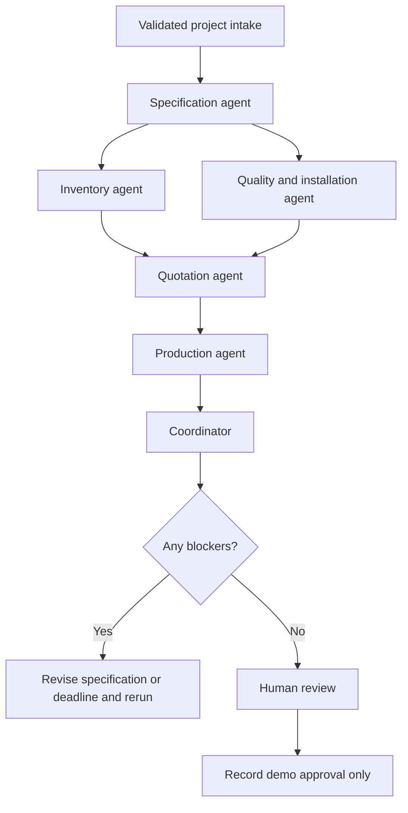

# Royal Blinds · Operations Studio

A multi-agent manufacturing project for an AI Engineer interview, tailored to Royal Blinds LLC. It combines discovery across Internal Shades, External Shades and Smart Solutions with a roller-blind/curtain estimating workflow: material calculations, AED estimates, capacity plans, inspection checks and human review.

This is an **independent interview prototype**, not an official Royal Blinds system. The initial customer records, material stock, product limits, prices, lead times and capacity are synthetic seed values. Supabase-backed mode reads your editable database records; replace sample values with approved company records before treating them as business facts. The company background supplied in the interview brief is context, not proof of product certifications or verified business policies.

The initial company knowledge base contains website text and links supplied by the user. In database mode the reviewed content is read from Supabase on each request. It is explicitly tagged `user_supplied_website_copy`; the pages were not independently fetched. Product titles establish portfolio membership. Technical page text, approved manuals and current model ratings have not been supplied.

## Stack

| Technology | Role |
|---|---|
| Python / FastAPI | Validated REST API and deterministic manufacturing tools |
| LangGraph | Six specialist nodes, shared typed state, parallel inventory and quality checks |
| React / TypeScript | Dashboard, intake form, reports, evidence inspector, quotation and review |
| Node.js / Vite | Frontend development server, build and browser tests |
| Supabase | Operational catalog, stock, costing/planning settings, knowledge and report storage through the trusted backend |
| OpenAI / NVIDIA chat APIs | Optional specialist summaries and retrieval-grounded answers; OpenAI embeddings for optional vector search |

Node.js powers the React development and build workflow. Python owns the application API; a second Node API is unnecessary for this scope.

## Start the project

Prerequisites: uv, Python 3.12, Node.js 22+, and npm. uv manages the backend's environment and dependencies using `backend/pyproject.toml` and `backend/uv.lock`. The Bash helper scripts below are for Linux/macOS/WSL; native Windows CMD instructions follow. Use this checkout directly; cloud tasks already run in isolation and need no Git worktree.

```bash
cd /workspace/DemoRoyalBlinds
bash scripts/setup.sh
bash scripts/start.sh
```

React runs on port **5173**, FastAPI on **8000**. FastAPI's interactive API documentation is at `/docs` on the backend. Keep the terminal running; Ctrl+C stops both services. The starter checks for occupied ports and fails rather than launching a duplicate instance.

The complete app works immediately with a local JSON report store in `.runtime/reports.json`. Without an API key, the interface explicitly says **Rule-based demo**: LangGraph coordinates specialist rules and tools, but no LLM runs. Reports survive a service restart; processes do not. uv creates or reuses `backend/.venv`; no manual activation is required. Python is pinned to 3.12, the supported and tested runtime for this project.

### Windows Command Prompt

Install the uv manager once using your existing Python 3.12 installation:

```cmd
py -3.12 -m pip install uv
```

Using `py -3.12 -m uv` avoids needing uv's executable directory on Windows PATH. Stop any existing backend with Ctrl+C. From the repository root (the folder containing both `backend` and `frontend`), open the backend CMD window:

```cmd
cd backend
py -3.12 -m uv sync --locked
if not exist .env copy .env.example .env
py -3.12 -m uv run --locked uvicorn app.main:app --reload --port 8000
```

In a second CMD window, starting in the repository root:

```cmd
cd frontend
npm ci --include=dev
npm run dev
```

If your CMD prompt already ends in `DemoRoyalBlinds\backend`, skip `cd backend`. uv reuses a compatible `.venv` there and synchronizes its packages to the lockfile. Existing `.env` files and local reports are preserved. An old repository-root `.venv` is no longer used by the helper scripts; it need not be deleted. The dependency list includes `tzdata`, which supplies the `Asia/Dubai` time zone on Windows.

On Linux/macOS/WSL, the equivalent backend commands are `cd backend`, `uv sync --locked`, and `uv run --locked uvicorn app.main:app --reload --port 8000`. Install uv using your platform's official installer or `python3 -m pip install uv` in a writable Python environment. The cloud machine already provides uv. `--locked` prevents setup from silently changing dependency versions.

`pyproject.toml` is the canonical dependency definition; `uv.lock` records the resolved versions, platforms and artifact hashes. For dependency changes, use `uv add <package>` or edit the manifest and run `uv lock`, then sync and run tests. Keep the pip-compatible export current with `uv export --locked --no-emit-project --output-file requirements.lock.txt` from `backend`. `requirements.txt` delegates to that generated, hashed export; it is not a second dependency definition.

## Enable real AI reasoning

Copy `backend/.env.example` to `backend/.env` without overwriting an existing configuration. Set `LLM_API_KEY` securely in that backend file or in your environment secret settings, and restart FastAPI. Do not commit keys or put them in React variables. The default endpoint is `https://api.openai.com/v1` with model `gpt-4.1-mini`.

For the NVIDIA-hosted model from your NVIDIA Build example, use:

```dotenv
LLM_BASE_URL=https://integrate.api.nvidia.com/v1
LLM_MODEL=openai/gpt-oss-20b
LLM_API_KEY=
KNOWLEDGE_RETRIEVAL_MODE=local
```

Enter your NVIDIA API key in `LLM_API_KEY` privately. An existing `NVIDIA_API_KEY` environment variable is also supported when the NVIDIA endpoint is selected and `LLM_API_KEY` is blank. The sample string `"$NVIDIA_API_KEY"` is a placeholder; Python does not expand it. In standalone Python code use `os.environ["NVIDIA_API_KEY"]` instead. Allow `integrate.api.nvidia.com` in a restricted cloud network policy. Hosted access, credits and rate limits depend on your NVIDIA account; this configuration does not guarantee unlimited free use.

The NVIDIA adapter uses ordinary chat completions, asks for JSON and validates the answer with Pydantic. It does not assume NVIDIA supports OpenAI's strict JSON-schema API feature. The provider's separate `reasoning_content` is neither displayed nor saved. Invalid or incomplete output falls back to labeled tool summaries or source excerpts. OpenAI retains its native structured-response adapter. `/api/health` reports the selected provider/model and whether a key is configured, without returning credentials.

With a key, all six nodes call the model with their calculated facts and record structured summaries and recommendations. Prices, dates and approval decisions still come from Python calculations. A provider failure is visibly labeled `rules_fallback`, not treated as successful AI execution. Key presence is only configuration evidence; confirm actual `llm` findings in the agent trace.

The selected provider receives the submitted brief and relevant project facts. This prototype should use synthetic data. It does not enable external tracing automatically.

## Connect all business data to Supabase

1. Use your dedicated `rbdemo` project (`neeupsyqguamtfmpanmp`).
2. Run [supabase/database_setup.sql](supabase/database_setup.sql) in its SQL editor. This complete, additive migration creates operational tables, seeds initial records, prepares the knowledge/vector tables and preserves existing project reports. Rerunning it preserves database edits to stock, rates, settings and source text. It replaces the need to run the separate schema/knowledge/operations files for a fresh setup; `demo_setup.sql` remains available only if you want the older seeded report examples.
3. Set the following in `backend/.env`, preserving existing NVIDIA settings:

```dotenv
SUPABASE_URL=https://neeupsyqguamtfmpanmp.supabase.co
SUPABASE_SERVICE_ROLE_KEY=
BUSINESS_DATA_SOURCE=supabase
KNOWLEDGE_RETRIEVAL_MODE=local
DATA_MODE=demo
```

Enter a backend server key privately in `SUPABASE_SERVICE_ROLE_KEY`: a current `sb_secret_...` or legacy `service_role` key. A publishable/anon key cannot read these tables. Do not put server keys in `.env.example`, Git or React variables. `DATA_MODE=demo` identifies this interview application; it does not select the business data source.

4. Restart the backend using the uv command above. From native Windows CMD in the repository root, verify read access without changing data:

```cmd
py -3.12 -m uv run --locked --project backend python backend/scripts/check_database.py
```

5. Confirm `/api/health` reports `business_data_source=supabase`; analyze a new project and inspect its agent findings and `data_snapshot`. Fresh analysis, rather than an old saved report, exercises the current data. Confirm it is saved in `public.demo_reports` and remains readable after a restart.

| Database table | Business data controlled here |
|---|---|
| `inventory_materials` | Material IDs, stock in linear metres, roll width, material cost, supplier lead time and product compatibility |
| `manufacturing_products` | Estimating model, product limits, hardware/motor prices, labour hours, cutting allowances, curtain fullness and inspection checklist |
| `manufacturing_settings` | Labour rates, margin, VAT, waste, factory/installation capacity, queue, inspection duration, working weekdays, holidays, exclusions and scenario presets |
| `company_products` | Full portfolio, categories, source URLs and links to available manufacturing profiles |
| `company_knowledge_chunks` | Editable source passages and optional vectors; text changes clear stale embeddings automatically |
| `company_knowledge_settings` | Category descriptions, source provenance and evidence limitations |
| `demo_reports` | Complete project reports, agent evidence, business snapshots and review records |

Each analysis reads one operational SQL snapshot plus one knowledge SQL snapshot and shares them across all six agents. No process-wide catalog cache is used. Stock, prices or settings changed after analysis apply to the next analysis; historical reports retain their captured values. Operational and knowledge snapshots are separate reads. Analysis makes no resource changes. A new human approval with execution authorization starts the post-approval workflow described below: atomic material reservation, capacity booking and work-order creation. Manufacturing completion consumes reserved sample material. No purchase orders, machine commands or external messages are sent.

`BUSINESS_DATA_SOURCE=auto` selects Supabase when both backend variables are set and otherwise selects offline demo fixtures. `supabase` requires database configuration and fails explicitly if it cannot read valid records. `demo` explicitly uses bundled fixtures in `backend/app/data` for offline testing. Database failures never silently fall back to sample stock or local knowledge. Optional vector-search failure can fall back to keyword search over the **same current database corpus**. Keyword retrieval from Supabase needs no embedding key and still supports NVIDIA-generated RAG answers.

All database tables use RLS without anonymous browser access; snapshot RPCs run with the caller's privileges and are executable only by `service_role`. The local API still needs authentication and authorization before public deployment. The initial migration is labeled sample data (`manufacturing_settings.is_sample=true`); database storage alone does not make those values verified company facts. After reviewing/replacing records, update the provenance and sample flag appropriately.

**Editable-stock demonstration:** In the Supabase table editor, change `inventory_materials.stock_lm` for `linen_blackout` from 28 to 100. Refresh the Material library and analyze the 24-blind shortage scenario again. Under the unchanged seed rules, the 68.69 lm requirement is now covered and the material blocker disappears. Change the value back after the demonstration. Changes do not retroactively rewrite old reports.

You can add material IDs and manufacturing profiles without changing Python/React enums. Profiles must use a supported `roller` or `curtain` calculation model, reference an existing knowledge product and include a checklist. New engineering models for awnings, pergolas and tensile structures require their own approved formulas and costing inputs; this migration does not invent them.

## Six specialists



| Specialist | Tool and evidence |
|---|---|
| Specification | Product catalog, structured dimensions and quantity; brief is context only |
| Inventory | Roll layout, whole-panel yield, allowances, 8% waste, stock and alternative fabrics |
| Quality & installation | Product limits, fabric compatibility and survey/installation checklist |
| Quotation | Itemized direct cost, 30% gross margin and illustrative 5% VAT |
| Production | Supplier lead time, factory queue, working-day capacity and installation sequence |
| Coordinator | Deterministic blockers, next steps and approval gate |

This is a constrained specialist workflow, rather than an autonomous open-ended agent conversation. Parallel inventory and quality nodes write separate state fields; a reducer merges their evidence traces. The quotation waits for both findings. Every node has a specialized role, a tool calculation and optional model reasoning. There is no fabricated conversational history or simulated agent progress.

## Five-minute interview demonstration

1. Open **The fabric shortfall**. Use the default 24 motorized rollers, each 1.8 × 2.4 m, with linen-look blackout fabric. Analyze the project.
2. Explain the inventory result: one panel fits the 3.2 m roll width; `24 × 2.65 × 1.08 = 68.69 lm`. With 28 lm available, the shortage is **40.69 lm**. Approval is disabled.
3. Inspect the **Agent findings** and expand inventory evidence. Explain the record IDs, formulas and difference between rules and live AI.
4. Click **Use & re-analyze** for performance blackout. The new report uses 120 lm demo stock and recomputes the price and plan. With the default flexible deadline it becomes eligible for human review.
5. Open **Quotation**: direct cost **AED 13,602.85**, selling subtotal **AED 19,432.64**, VAT **AED 971.63**, total **AED 20,404.27**. Gross margin is `cost ÷ (1 − 0.30)`, not a 30% markup.
6. Review **Production & quality**, then approve the demo estimate with the three review confirmations plus explicit demo execution authorization. The Work order tab shows the reservation, booked dates, tasks and activity log. Continue through production, quality and installation using the progress controls.
7. Start **The urgent fit-out**. The five-day deadline fails even if you select an available fabric. Show how the coordinator prevents an unrealistic promise.

Dates are calculated using the current Dubai date, so calendar results vary with the demo day. Monday–Friday working days, a two-day queue, six productive hours/day, and supplier lead times are explicit assumptions. Public holidays and live bookings are not included.

## Validation

```bash
# Backend calculations, graph execution, API, persistence and approval enforcement
cd /workspace/DemoRoyalBlinds/backend
uv run --locked pytest -q

# TypeScript and production frontend build
cd /workspace/DemoRoyalBlinds/frontend
npm run build

# Browser workflows; /usr/bin/chromium is available in this cloud machine
CHROMIUM_PATH=/usr/bin/chromium npm run test:e2e
```

On another machine, install Playwright's Chromium with `npx playwright install chromium` and omit `CHROMIUM_PATH`. Browser tests start an isolated offline backend on 8010 and frontend on 5180, with a unique local report file for each run. Supabase/LLM environment values are overridden with blanks for those test services. No running app or Supabase inventory is used by browser approval tests.

## API

| Method | Path | Purpose |
|---|---|---|
| GET | `/api/health` | Runtime mode and Dubai date |
| GET | `/api/catalog` | Demo materials and products |
| POST | `/api/projects/analyze` | Run the graph and persist the resulting report |
| GET | `/api/projects` | Latest 50 reports |
| GET | `/api/projects/{id}` | One report and its evidence |
| POST | `/api/projects/{id}/approve` | Require review/execution consent, atomically queue actions, safely return an existing approval on retry |
| POST | `/api/projects/{id}/execute` | Retry a queued or blocked post-approval job without duplicating effects |
| POST | `/api/projects/{id}/work-order/actions` | Record manufacturing, quality, installation or cancellation progress |

## Scope and next steps

The current estimating workflow supports motorized rollers, manual rollers and manual-track curtains with one uniform opening size per project. Product discovery covers the supplied internal, external and smart portfolio. Tensile structures, retractable roofs, awnings and canopies require different engineering and costing models and are not supported by the estimating tools. Add mixed opening schedules, supplier-backed lead times and verified product ratings before expanding estimation scope.

This version is for a private interview demo. FastAPI has no user authentication: reviewer names are attestations, not verified identities. Supabase RLS protects direct browser database access, but does not authenticate the API. Before public deployment, add Supabase Auth, backend JWT validation, role checks, per-user/organization report access, rate limiting and an immutable audit log. Local JSON storage supports one backend process only; use Supabase for multiple processes. The reservation/booking workflow is bounded to sample data. Supplier commitments, verified operator roles and real factory integrations remain separate production work.

Live OpenAI, NVIDIA and Supabase integration need your configured accounts and were not verified without credentials. Local behavior, business snapshot updates, the NVIDIA adapter and provider failures are tested independently. Eleven integration checks run against a disposable PostgreSQL/pgvector database, including migration/RLS, preservation on rerun, vector invalidation, atomic approval, stock reservation races, capacity/deadline rollback, stale prices, cancellation and guarded production progress. Supabase SDK RPC transport is also tested using mocked HTTP; this is distinct from live access to rbdemo.

## Product knowledge and RAG

Open **Product knowledge** in the dashboard. The supplied portfolio has eight internal product types (roller, Venetian, wooden, vertical, Roman, zebra roller, curtains and cubicle curtains) and seven external types (car parking shades, sail shades, bioclimatic pergolas, tensile shade structures, awnings, outdoor furniture and umbrellas). Smart Solutions is an automation/control layer across applicable products; universal compatibility is not assumed.

The source register links company, internal, external and smart content to its supplied URLs and section headings. Individual linked product titles are included as listing evidence only. Original seed evidence is in [backend/app/data/company_knowledge.json](backend/app/data/company_knowledge.json). Database mode reads current passages and metadata from Supabase; offline mode uses this seed corpus. `backend/app/knowledge.py` ranks the selected corpus.

Try these enquiries:

- `What outdoor shade products does Royal Blinds offer?`
- `Can motorized roller blinds use smartphone control and a rechargeable battery?`
- `What is the maximum wind speed rating for awnings?`

The third enquiry deliberately flags an evidence gap. Marketing copy cannot confirm wind ratings, motor voltage/torque, device compatibility, valid certifications, current prices, stock or warranty terms. Product estimation buttons are offered only for the existing roller-blind and curtain models. Other product types support discovery and technical enquiry, not fabricated estimates.

Retrieval and generation are separate:

| Configuration | Actual behavior |
|---|---|
| `KNOWLEDGE_RETRIEVAL_MODE=local`, no LLM key | BM25-style keyword retrieval and original source excerpts; no generated AI answer |
| Local retrieval with `LLM_API_KEY` | RAG: retrieved passages feed a structured model answer with validated source IDs |
| `KNOWLEDGE_RETRIEVAL_MODE=supabase_vector` after indexing | 1536-dimensional OpenAI embeddings and Supabase cosine search, with category/product filters |

Vector failure or an unindexed corpus visibly falls back to local retrieval. Model failure or invalid citations visibly falls back to source excerpts. Scores express retrieval relevance, never factual confidence. Database vector matches are accepted only when IDs and content match the current knowledge snapshot; stale matches cannot replace its source text or citation links. The specification and quality agents use this same retrieval tool and persist their passages as report evidence; prices and scheduling calculations remain controlled by Python.

The complete `database_setup.sql` already prepares knowledge storage. The standalone [supabase/knowledge_base.sql](supabase/knowledge_base.sql) creates knowledge tables only; it also needs `operations.sql` for metadata and snapshot RPCs before this backend can use database mode. **This is a separate migration from `demo_setup.sql`.** It adds `company_products`, `company_knowledge_chunks` and the `match_company_knowledge` RPC, preserving existing records and embeddings on repeat runs. Editing passage text in the database clears its old embedding through a trigger. It neither changes existing project reports nor enables anonymous access. All access stays on the backend service role.

SQL seeds the source text without overwriting edited records; it does not generate embeddings. For NVIDIA chat, keep local retrieval to use RAG without an embedding API. Optional vector indexing currently uses OpenAI's `text-embedding-3-small`, so it requires a separate OpenAI key in `EMBEDDING_API_KEY`. The NVIDIA chat key is never sent to OpenAI. Existing OpenAI chat deployments may reuse their `LLM_API_KEY` when `EMBEDDING_API_KEY` is blank.

Once `SUPABASE_URL`, `SUPABASE_SERVICE_ROLE_KEY` and the embedding key are securely configured, run:

```bash
cd /workspace/DemoRoyalBlinds
uv run --locked --project backend python backend/scripts/index_knowledge.py
```

The script reads the current database corpus, skips already indexed passages, generates `text-embedding-3-small` embeddings, writes them with a content predicate, and verifies a self-match through the RPC. It makes paid embedding requests to the provider. Only after it succeeds, set `KNOWLEDGE_RETRIEVAL_MODE=supabase_vector` on the backend and restart. Confirm an actual response reports `retrieval_mode=supabase_vector`; configuration alone is not verification.

The knowledge API is `GET /api/knowledge/portfolio` and `POST /api/knowledge/ask`. The latter accepts `question`, optional `category` (`internal`, `external`, `smart`, `company`) and optional `product_id` from the portfolio. It returns answer mode, actual retrieval mode, source passages, provenance and review requirements.

In Supabase mode, edit reviewed source records in the database. Bundled JSON files are offline fixtures and migration seeds. To update those seed files and rebuild the knowledge-only migration, use `uv run --locked --project backend python backend/scripts/export_knowledge_sql.py`. Review the generated migration before applying it. Approved product datasheets and manuals should become a separately identified source class before adding engineering-dependent decisions; the current corpus contains marketing context only.

On Windows, substitute `py -3.12 -m uv` for `uv` in the validation and knowledge-indexing commands above.

## Database development checks

Regular `uv run --locked pytest -q` uses explicit offline fixtures and mocked Supabase responses. The optional `tests/test_database_sql.py` runs only when `DATABASE_TEST_URL` points to an empty **disposable** PostgreSQL database with pgvector available and administrator permissions. It creates Supabase-like roles/schema and synthetic data. Never point it at rbdemo or a production database. Install `psycopg[binary]` in a separate test tooling environment to run it; this is not an application dependency. A skipped SQL integration module is not evidence of a successful live database test.

Generate the full migration and standalone components after an authorized seed/schema change with `uv run --locked --project backend python backend/scripts/export_database_sql.py`. Review the generated SQL before applying it. Reruns intentionally preserve existing data; changing a seed file does not replace an existing database value.

## After quotation approval

For an existing rbdemo database, apply **[supabase/post_approval.sql](supabase/post_approval.sql)** once in the SQL editor, then restart the backend. This upgrade adds six tables and replaces the operational snapshot RPC to account for reservations. It preserves stock balances, settings and existing reports. For a new database, the current `database_setup.sql` includes this upgrade. Historical approved reports are not automatically executed; analyze and approve a fresh project.

New approval requires the three review confirmations **and** “I authorize demo material reservation and work-order creation.” The API stores the approval and a unique queued job in one transaction. A second LangGraph workflow validates the approval, prepares inventory/production/quality/installation handoffs and calls one transactional execution tool. The tool rechecks current specifications, prices, policy, stock and bookings before creating any resources. Changes to quote terms require a fresh analysis/approval; an inventory or capacity shortfall blocks execution without partial reservations/orders. Report approval and execution status are separate: a quote can be accepted while execution needs attention.

The database workflow is enabled only while `manufacturing_settings.is_sample=true`, matching the app's interview scope. Setting it false keeps read-only business analysis available but disables these demo execution/progress actions. Role authentication and operational integrations must be implemented before enabling actions on real company records. `DATA_MODE=demo` remains required.

| New table | Responsibility |
|---|---|
| `approval_jobs` | Durable queue, status, blocker reason and agent handoffs; one job per report |
| `work_orders` | Booked plan and progress state; one work order per report |
| `material_reservations` | Active, consumed or released fabric allocation; one allocation per report |
| `production_bookings` | Factory and installation hours by working date |
| `work_order_tasks` | Manufacturing task, required quality checks and installation handover |
| `project_events` | Approval, execution, quality, progress and cancellation audit entries |

Approval reserves material without reducing physical on-hand stock. The Material library reports **available**, **on hand** and **reserved** quantities. In the SQL editor, `inventory_materials.stock_lm` is on-hand stock; `/api/catalog` exposes `stock_lm` as available stock after active reservations. Reservation and capacity locks prevent two simultaneous approvals from overselling the same material or overbooking daily hours.

Progress is explicit: **Ready for production → In production → Awaiting quality checks → Ready for installation → Completed**. “Record manufacturing complete” consumes material exactly once. Quality approval requires every current checklist ID; failed quality holds installation until checks are repeated. Cancellation before production releases material and bookings. After manufacturing, cancellation releases unused installation bookings but retains consumed material and factory history. A started manufacturing order must finish/report consumption before cancellation; the system does not assume partially processed fabric can be returned.

`POST_APPROVAL_WORKER_ENABLED=true` starts a lightweight worker with FastAPI. It polls queued approvals every ten seconds and recovers after a restart. Blocked jobs require explicit Retry execution after resolving the issue. Approval and effect commits are distinct transactions linked by the durable queue. The terminal effect transaction is atomic and idempotent; a lost response or competing workers cannot duplicate resources. This design uses durable database jobs and idempotent tools, not an in-memory pause or a LangGraph checkpoint backend.

Demo journey: analyze four Performance-blackout rollers with a flexible deadline, approve with execution consent, inspect the Work order tab, start production, record manufacturing complete, confirm all quality checks, and record installation complete. Reopen the saved report to verify persistence. Test cancellation on a separate project before production. Resource reservations affect later analyses, so repeated large-order demonstrations may require cancellation/replenishment in the sample dataset.

Notifications currently mean the in-app activity log only. No customer/supplier emails, purchasing, equipment control or automatic declarations of finished work are performed. Operators explicitly attest to progress; their names are not authenticated identities in this private prototype.
