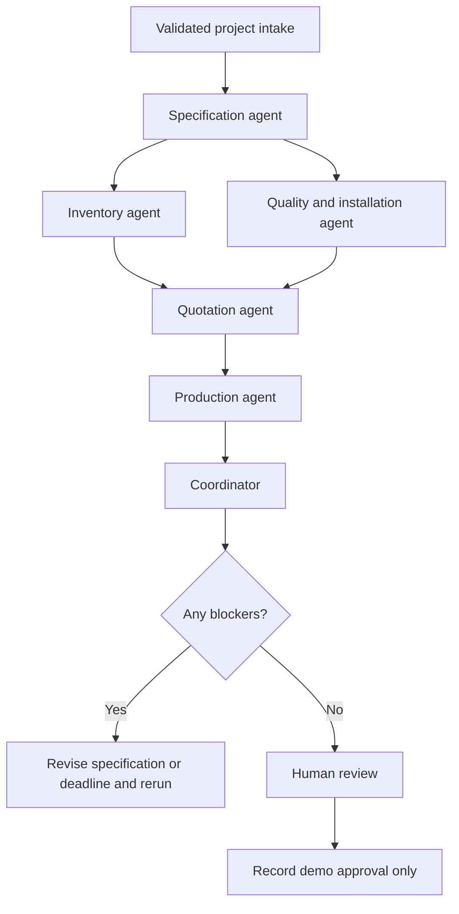

# Royal Blinds · Operations Studio

A multi-agent manufacturing project for an AI Engineer interview, tailored to Royal Blinds LLC. It combines discovery across Internal Shades, External Shades and Smart Solutions with a roller-blind/curtain estimating workflow: material calculations, AED estimates, capacity plans, inspection checks and human review.

This is an **independent interview prototype**, not an official Royal Blinds system. All customer records, material stock, product ratings, prices, lead times, and capacity are synthetic. The company background supplied in the interview brief is context, not proof of product certifications or verified business policies.

The company knowledge base contains website text and links supplied by the user. It is explicitly tagged `user_supplied_website_copy`; the pages were not independently fetched. Product titles establish portfolio membership. Technical page text, approved manuals and current model ratings have not been supplied.

## Stack

| Technology | Role |
|---|---|
| Python / FastAPI | Validated REST API and deterministic manufacturing tools |
| LangGraph | Six specialist nodes, shared typed state, parallel inventory and quality checks |
| React / TypeScript | Dashboard, intake form, reports, evidence inspector, quotation and review |
| Node.js / Vite | Frontend development server, build and browser tests |
| Supabase | Optional Postgres report storage and pgvector retrieval through the trusted backend |
| OpenAI / NVIDIA chat APIs | Optional specialist summaries and retrieval-grounded answers; OpenAI embeddings for optional vector search |

Node.js powers the React development and build workflow. Python owns the application API; a second Node API is unnecessary for this scope.

## Start the project

Prerequisites: uv, Python 3.12, Node.js 22+, and npm. uv manages the backend's environment and dependencies using `backend/pyproject.toml` and `backend/uv.lock`. The Bash helper scripts below are for Linux/macOS/WSL; native Windows CMD instructions follow. Use this checkout directly; cloud tasks already run in isolation and need no Git worktree.

```bash
cd /workspace/DemoRoyalBlinds
bash scripts/setup.sh
bash scripts/start.sh
```

React runs on port **5173**, FastAPI on **8000**. FastAPI's interactive API documentation is at `/docs` on the backend. Keep the terminal running; Ctrl+C stops both services. The starter checks for occupied ports and fails rather than launching a duplicate instance.

The complete app works immediately with a local JSON report store in `.runtime/reports.json`. Without an API key, the interface explicitly says **Rule-based demo**: LangGraph coordinates specialist rules and tools, but no LLM runs. Reports survive a service restart; processes do not. uv creates or reuses `backend/.venv`; no manual activation is required. Python is pinned to 3.12, the supported and tested runtime for this project.

### Windows Command Prompt

Install the uv manager once using your existing Python 3.12 installation:

```cmd
py -3.12 -m pip install uv
```

Using `py -3.12 -m uv` avoids needing uv's executable directory on Windows PATH. Stop any existing backend with Ctrl+C. From the repository root (the folder containing both `backend` and `frontend`), open the backend CMD window:

```cmd
cd backend
py -3.12 -m uv sync --locked
if not exist .env copy .env.example .env
py -3.12 -m uv run --locked uvicorn app.main:app --reload --port 8000
```

In a second CMD window, starting in the repository root:

```cmd
cd frontend
npm ci --include=dev
npm run dev
```

If your CMD prompt already ends in `DemoRoyalBlinds\backend`, skip `cd backend`. uv reuses a compatible `.venv` there and synchronizes its packages to the lockfile. Existing `.env` files and local reports are preserved. An old repository-root `.venv` is no longer used by the helper scripts; it need not be deleted. The dependency list includes `tzdata`, which supplies the `Asia/Dubai` time zone on Windows.

On Linux/macOS/WSL, the equivalent backend commands are `cd backend`, `uv sync --locked`, and `uv run --locked uvicorn app.main:app --reload --port 8000`. Install uv using your platform's official installer or `python3 -m pip install uv` in a writable Python environment. The cloud machine already provides uv. `--locked` prevents setup from silently changing dependency versions.

`pyproject.toml` is the canonical dependency definition; `uv.lock` records the resolved versions, platforms and artifact hashes. For dependency changes, use `uv add <package>` or edit the manifest and run `uv lock`, then sync and run tests. Keep the pip-compatible export current with `uv export --locked --no-emit-project --output-file requirements.lock.txt` from `backend`. `requirements.txt` delegates to that generated, hashed export; it is not a second dependency definition.

## Enable real AI reasoning

Copy `backend/.env.example` to `backend/.env` without overwriting an existing configuration. Set `LLM_API_KEY` securely in that backend file or in your environment secret settings, and restart FastAPI. Do not commit keys or put them in React variables. The default endpoint is `https://api.openai.com/v1` with model `gpt-4.1-mini`.

For the NVIDIA-hosted model from your NVIDIA Build example, use:

```dotenv
LLM_BASE_URL=https://integrate.api.nvidia.com/v1
LLM_MODEL=openai/gpt-oss-20b
LLM_API_KEY=
KNOWLEDGE_RETRIEVAL_MODE=local
```

Enter your NVIDIA API key in `LLM_API_KEY` privately. An existing `NVIDIA_API_KEY` environment variable is also supported when the NVIDIA endpoint is selected and `LLM_API_KEY` is blank. The sample string `"$NVIDIA_API_KEY"` is a placeholder; Python does not expand it. In standalone Python code use `os.environ["NVIDIA_API_KEY"]` instead. Allow `integrate.api.nvidia.com` in a restricted cloud network policy. Hosted access, credits and rate limits depend on your NVIDIA account; this configuration does not guarantee unlimited free use.

The NVIDIA adapter uses ordinary chat completions, asks for JSON and validates the answer with Pydantic. It does not assume NVIDIA supports OpenAI's strict JSON-schema API feature. The provider's separate `reasoning_content` is neither displayed nor saved. Invalid or incomplete output falls back to labeled tool summaries or source excerpts. OpenAI retains its native structured-response adapter. `/api/health` reports the selected provider/model and whether a key is configured, without returning credentials.

With a key, all six nodes call the model with their calculated facts and record structured summaries and recommendations. Prices, dates and approval decisions still come from Python calculations. A provider failure is visibly labeled `rules_fallback`, not treated as successful AI execution. Key presence is only configuration evidence; confirm actual `llm` findings in the agent trace.

The selected provider receives the submitted brief and relevant project facts. This prototype should use synthetic data. It does not enable external tracing automatically.

## Connect Supabase

1. Create a dedicated **demo** Supabase project.
2. Run [supabase/schema.sql](supabase/schema.sql) in its SQL editor.
   To also populate three complete, dashboard-compatible synthetic reports, run [supabase/demo_setup.sql](supabase/demo_setup.sql) instead. It includes the table schema and preserves existing reports on reruns. These fixtures are labeled **Seeded demo**; their SQL calculations do not execute LangGraph or an LLM. Analyze a fresh brief to run the agent workflow.
3. Set `SUPABASE_URL` and `SUPABASE_SERVICE_ROLE_KEY` securely on the FastAPI backend. Both must be present, or both absent. The key can be a current server secret key (`sb_secret_...`) or a legacy `service_role` key; a publishable/anon key cannot access this table. Keep the variable name `SUPABASE_SERVICE_ROLE_KEY` for either server key format.
4. Restart the backend. Analyze a project and verify it appears in `public.demo_reports` and survives a restart.

The backend is the only Supabase client. The database table enables RLS and denies `anon` and `authenticated` access; the backend service role accesses it. The role key must never enter the browser or a `VITE_*` variable. Existing local reports are not automatically migrated. Network access must allow your exact `<project-ref>.supabase.co` hostname.

Supabase stores report snapshots and review status. The demonstration catalog remains in Python fixtures; this version does not read live stock, alter inventory, reserve materials or dispatch orders. A failed database write returns an explicit service error; it does not silently switch to local storage. Health reports the selected configuration, not a verified Supabase connection; analyze/list requests provide that verification.

## Six specialists



| Specialist | Tool and evidence |
|---|---|
| Specification | Product catalog, structured dimensions and quantity; brief is context only |
| Inventory | Roll layout, whole-panel yield, allowances, 8% waste, stock and alternative fabrics |
| Quality & installation | Product limits, fabric compatibility and survey/installation checklist |
| Quotation | Itemized direct cost, 30% gross margin and illustrative 5% VAT |
| Production | Supplier lead time, factory queue, working-day capacity and installation sequence |
| Coordinator | Deterministic blockers, next steps and approval gate |

This is a constrained specialist workflow, rather than an autonomous open-ended agent conversation. Parallel inventory and quality nodes write separate state fields; a reducer merges their evidence traces. The quotation waits for both findings. Every node has a specialized role, a tool calculation and optional model reasoning. There is no fabricated conversational history or simulated agent progress.

## Five-minute interview demonstration

1. Open **The fabric shortfall**. Use the default 24 motorized rollers, each 1.8 × 2.4 m, with linen-look blackout fabric. Analyze the project.
2. Explain the inventory result: one panel fits the 3.2 m roll width; `24 × 2.65 × 1.08 = 68.69 lm`. With 28 lm available, the shortage is **40.69 lm**. Approval is disabled.
3. Inspect the **Agent findings** and expand inventory evidence. Explain the record IDs, formulas and difference between rules and live AI.
4. Click **Use & re-analyze** for performance blackout. The new report uses 120 lm demo stock and recomputes the price and plan. With the default flexible deadline it becomes eligible for human review.
5. Open **Quotation**: direct cost **AED 13,602.85**, selling subtotal **AED 19,432.64**, VAT **AED 971.63**, total **AED 20,404.27**. Gross margin is `cost ÷ (1 − 0.30)`, not a 30% markup.
6. Review **Production & quality**, then approve the demo estimate with all three confirmations. It records the reviewer without executing a business action.
7. Start **The urgent fit-out**. The five-day deadline fails even if you select an available fabric. Show how the coordinator prevents an unrealistic promise.

Dates are calculated using the current Dubai date, so calendar results vary with the demo day. Monday–Friday working days, a two-day queue, six productive hours/day, and supplier lead times are explicit assumptions. Public holidays and live bookings are not included.

## Validation

```bash
# Backend calculations, graph execution, API, persistence and approval enforcement
cd /workspace/DemoRoyalBlinds/backend
uv run --locked pytest -q

# TypeScript and production frontend build
cd /workspace/DemoRoyalBlinds/frontend
npm run build

# Browser workflows; /usr/bin/chromium is available in this cloud machine
CHROMIUM_PATH=/usr/bin/chromium npm run test:e2e
```

On another machine, install Playwright's Chromium with `npx playwright install chromium` and omit `CHROMIUM_PATH`. Browser tests start both services if they are not already running. They create synthetic demo reports. Use a separate backend environment/store when testing against Supabase.

## API

| Method | Path | Purpose |
|---|---|---|
| GET | `/api/health` | Runtime mode and Dubai date |
| GET | `/api/catalog` | Demo materials and products |
| POST | `/api/projects/analyze` | Run the graph and persist the resulting report |
| GET | `/api/projects` | Latest 50 reports |
| GET | `/api/projects/{id}` | One report and its evidence |
| POST | `/api/projects/{id}/approve` | Require three confirmations, reject blockers and duplicate approval |

## Scope and next steps

The current estimating workflow supports motorized rollers, manual rollers and manual-track curtains with one uniform opening size per project. Product discovery covers the supplied internal, external and smart portfolio. Tensile structures, retractable roofs, awnings and canopies require different engineering and costing models and are not supported by the estimating tools. Add mixed opening schedules, supplier-backed lead times and verified product ratings before expanding estimation scope.

This version is for a private interview demo. FastAPI has no user authentication: reviewer names are attestations, not verified identities. Supabase RLS protects direct browser database access, but does not authenticate the API. Before public deployment, add Supabase Auth, backend JWT validation, role checks, per-user/organization report access, rate limiting and an immutable audit log. Local JSON storage supports one backend process only; use Supabase for multiple processes. Inventory reservations, supplier commitments and real production integrations are separate implementation work.

Live OpenAI, NVIDIA and Supabase integration need your configured accounts and were not verified without credentials. Local demo behavior, the NVIDIA request/response adapter and provider failure handling are tested independently with mocked API transport.

## Product knowledge and RAG

Open **Product knowledge** in the dashboard. The supplied portfolio has eight internal product types (roller, Venetian, wooden, vertical, Roman, zebra roller, curtains and cubicle curtains) and seven external types (car parking shades, sail shades, bioclimatic pergolas, tensile shade structures, awnings, outdoor furniture and umbrellas). Smart Solutions is an automation/control layer across applicable products; universal compatibility is not assumed.

The source register links company, internal, external and smart content to its supplied URLs and section headings. Individual linked product titles are included as listing evidence only. Original evidence, source kind and stable chunk IDs are stored in [backend/app/data/company_knowledge.json](backend/app/data/company_knowledge.json) and indexed by `backend/app/knowledge.py`.

Try these enquiries:

- `What outdoor shade products does Royal Blinds offer?`
- `Can motorized roller blinds use smartphone control and a rechargeable battery?`
- `What is the maximum wind speed rating for awnings?`

The third enquiry deliberately flags an evidence gap. Marketing copy cannot confirm wind ratings, motor voltage/torque, device compatibility, valid certifications, current prices, stock or warranty terms. Product estimation buttons are offered only for the existing roller-blind and curtain models. Other product types support discovery and technical enquiry, not fabricated estimates.

Retrieval and generation are separate:

| Configuration | Actual behavior |
|---|---|
| `KNOWLEDGE_RETRIEVAL_MODE=local`, no LLM key | BM25-style keyword retrieval and original source excerpts; no generated AI answer |
| Local retrieval with `LLM_API_KEY` | RAG: retrieved passages feed a structured model answer with validated source IDs |
| `KNOWLEDGE_RETRIEVAL_MODE=supabase_vector` after indexing | 1536-dimensional OpenAI embeddings and Supabase cosine search, with category/product filters |

Vector failure or an unindexed corpus visibly falls back to local retrieval. Model failure or invalid citations visibly falls back to source excerpts. Scores express retrieval relevance, never factual confidence. Database matches are accepted only when IDs and content match the reviewed bundled corpus. The specification and quality agents use this same retrieval tool and persist their passages as report evidence; prices and scheduling calculations remain controlled by Python.

To prepare Supabase knowledge storage, run [supabase/knowledge_base.sql](supabase/knowledge_base.sql) in the SQL editor. **This is a separate migration from `demo_setup.sql`.** It adds `company_products`, `company_knowledge_chunks` and the `match_company_knowledge` RPC, retaining unchanged embeddings on repeat runs. Changed passage text clears its old embedding. It neither changes existing project reports nor enables anonymous access. All access stays on the backend service role.

SQL seeds the source text; it does not generate embeddings. For NVIDIA chat, keep local retrieval to use RAG without an embedding API. Optional vector indexing currently uses OpenAI's `text-embedding-3-small`, so it requires a separate OpenAI key in `EMBEDDING_API_KEY`. The NVIDIA chat key is never sent to OpenAI. Existing OpenAI chat deployments may reuse their `LLM_API_KEY` when `EMBEDDING_API_KEY` is blank.

Once `SUPABASE_URL`, `SUPABASE_SERVICE_ROLE_KEY` and the embedding key are securely configured, run:

```bash
cd /workspace/DemoRoyalBlinds
uv run --locked --project backend python backend/scripts/index_knowledge.py
```

The script checks corpus consistency, skips already indexed passages, generates `text-embedding-3-small` embeddings, writes them with a content predicate, and verifies a self-match through the RPC. It makes paid embedding requests to the provider. Only after it succeeds, set `KNOWLEDGE_RETRIEVAL_MODE=supabase_vector` on the backend and restart. Confirm an actual response reports `retrieval_mode=supabase_vector`; configuration alone is not verification.

The knowledge API is `GET /api/knowledge/portfolio` and `POST /api/knowledge/ask`. The latter accepts `question`, optional `category` (`internal`, `external`, `smart`, `company`) and optional `product_id` from the portfolio. It returns answer mode, actual retrieval mode, source passages, provenance and review requirements.

For future source edits, change the reviewed JSON and rebuild the migration with `uv run --locked --project backend python backend/scripts/export_knowledge_sql.py`. Review the generated migration before applying it. Approved product datasheets and manuals should become a separately identified source class before adding engineering-dependent decisions; the current corpus contains marketing context only.

On Windows, substitute `py -3.12 -m uv` for `uv` in the validation and knowledge-indexing commands above.
