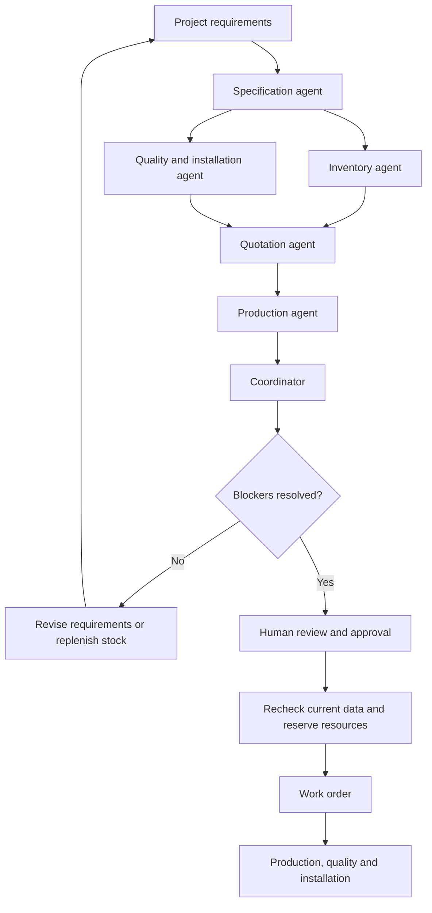

# Royal Blinds Operations Studio

A manufacturing operations application that combines multi-agent quotation analysis, product knowledge, inventory checks, production planning and human-approved work orders. Built with Python, FastAPI, LangGraph, React and Supabase, it brings project requirements and their supporting evidence into one workspace.

The application is tailored to Royal Blinds' Internal Shades, External Shades and Smart Solutions portfolio. Product discovery covers the broader portfolio; the current quotation engine supports motorized roller blinds, manual roller blinds and manual-track curtains.

## Key capabilities

- **Quotation analysis:** Validate dimensions and quantities, calculate material requirements, check stock, estimate costs in AED and assess delivery feasibility.
- **Six specialist agents:** Coordinate specification, inventory, quality, quotation, production and final review through LangGraph.
- **Knowledge assistant:** Answer company and product questions using current source records, optional category filters and visible citations.
- **Material and knowledge management:** Add reviewed knowledge and materials directly to Supabase through validated forms.
- **Human approval:** Require review confirmations before reserving materials, booking capacity and creating a work order.
- **Execution tracking:** Record production, quality checks, installation, cancellation and activity history.
- **Persistent reports:** Retain the business-data snapshot, calculations, agent evidence and approval associated with each quotation.
- **Controlled access:** Support Supabase sign-in and confirmed, invited accounts for hosted deployments.

This is an independently developed application for evaluation. Initial stock, prices, lead times, capacity and customer records are sample data. Company knowledge is based on supplied website content and reviewed additions; marketing descriptions do not establish verified technical ratings. Operational execution currently remains restricted to sample records.

## Technology stack

| Technology                         | Responsibility                                                                                |
| ---------------------------------- | --------------------------------------------------------------------------------------------- |
| Python 3.12 / FastAPI              | REST API, validation, manufacturing calculations and persistence                              |
| LangGraph                          | Specialist coordination and post-approval execution workflows                                 |
| React / TypeScript                 | Project workspace, reports, material library and knowledge assistant                          |
| Node.js / Vite                     | Frontend development, build and browser testing                                               |
| Supabase                           | PostgreSQL business records, knowledge, reports, transactional work orders and authentication |
| OpenAI / NVIDIA-compatible APIs    | Optional agent commentary and retrieval-grounded answers                                      |
| Docker / Google Cloud Run / Vercel | Backend container and frontend hosting configuration                                          |

## Agent workflow



| Agent                    | Responsibility                                                                                |
| ------------------------ | --------------------------------------------------------------------------------------------- |
| Specification            | Validate the selected manufacturing profile, dimensions and project requirements              |
| Inventory                | Calculate roll layout, cutting allowances, waste, available stock and compatible alternatives |
| Quality and installation | Check product limits, material compatibility and inspection requirements                      |
| Quotation                | Calculate material, hardware, motor and labour costs, margin, VAT and selling price           |
| Production               | Assess supplier lead times, working dates, factory capacity and installation scheduling       |
| Coordinator              | Consolidate findings, explain blockers and determine eligibility for human review             |

Inventory and quality checks run in parallel. Quotation waits for both findings before the remaining stages proceed. Python tools control quantities, pricing, dates and approval gates; optional language-model calls add commentary and recommendations. The trace identifies actual AI output and rule-based fallbacks.

## Knowledge assistant and RAG

The assistant uses three answer paths:

| Question type                                      | Answer path                                                                                 |
| -------------------------------------------------- | ------------------------------------------------------------------------------------------- |
| Product ranges                                     | Complete lookup of the current product catalog with citations                               |
| Company ownership, contacts, locations and history | Direct lookup of answer-bearing sentences in current company-profile sources                |
| Other product questions                            | Retrieve relevant passages, then generate a cited answer when a chat provider is configured |

The optional category selector defaults to **All categories** and supports Company profile, Internal Shades, External Shades and Smart Solutions. Product browsing has its own independent filter.

`KNOWLEDGE_RETRIEVAL_MODE=local` uses keyword ranking over the selected knowledge corpus. With a configured chat provider, these passages ground the generated answer. `supabase_vector` uses Supabase cosine search after embedding the knowledge records. Vector retrieval currently requires OpenAI embeddings; NVIDIA chat can use keyword retrieval without an embedding service.

Generated citation IDs are checked against retrieved sources. Invalid responses and provider failures return labeled source excerpts. Citation validation establishes source references, rather than proving every generated claim. Missing technical specifications, current certifications, warranty terms or live operational facts are reported as evidence gaps.

**Add knowledge** saves reviewed passages in `company_knowledge_chunks`; new records are immediately eligible for keyword retrieval. Text edits clear stale embeddings. Use Company profile for corporate facts and the relevant product category for product enquiries. **Add material** saves stock, costs, roll width, lead time and compatible profiles in `inventory_materials`. Both forms require Supabase mode, validate inputs and use stable request IDs for safe retries.

## Getting started

Requirements: **Python 3.12**, **uv**, **Node.js 22+** and **npm**. Clone the repository, then start the backend and frontend in separate terminals.

### Windows Command Prompt

Install uv once:

```cmd
py -3.12 -m pip install uv
```

From the repository root, start the backend:

```cmd
cd backend
py -3.12 -m uv sync --locked
if not exist .env copy .env.example .env
py -3.12 -m uv run --locked uvicorn app.main:app --reload --port 8000
```

In a second terminal, from the repository root:

```cmd
cd frontend
npm ci --include=dev
npm run dev
```

If your terminal is already inside `backend` or `frontend`, omit the corresponding `cd` command. After pulling dependency changes, rerun `uv sync --locked` or `npm ci --include=dev` before restarting the affected service.

### Linux, macOS or WSL

From the repository root:

```bash
bash scripts/setup.sh
bash scripts/start.sh
```

The setup script installs locked dependencies and builds the frontend. The start script runs both services and checks for occupied ports. Stop them with Ctrl+C.

| Service           | Local address              |
| ----------------- | -------------------------- |
| Application       | http://localhost:5173      |
| Backend           | http://127.0.0.1:8000      |
| API documentation | http://127.0.0.1:8000/docs |

Without database credentials, the application uses bundled sample records and persists reports in `.runtime/reports.json`. Without a chat API key, specialist analysis uses deterministic tools and Q&A returns source-based answers. Local JSON persistence supports one backend process. API documentation is available in local development and hidden when authentication is enabled.

## Configuration

Backend settings belong in `backend/.env`; see [backend/.env.example](backend/.env.example) for the complete configuration. Keep credentials out of Git and frontend variables.

| Variable                       | Purpose                                                                |
| ------------------------------ | ---------------------------------------------------------------------- |
| `BUSINESS_DATA_SOURCE`         | `auto`, explicit `supabase`, or offline `demo`                         |
| `SUPABASE_URL`                 | Supabase project endpoint                                              |
| `SUPABASE_SERVICE_ROLE_KEY`    | Backend server secret or legacy service-role key                       |
| `LLM_API_KEY`                  | Chat-provider credential; blank enables rule-based operation           |
| `LLM_BASE_URL` / `LLM_MODEL`   | Chat endpoint and model                                                |
| `KNOWLEDGE_RETRIEVAL_MODE`     | `local` keyword retrieval or indexed `supabase_vector`                 |
| `EMBEDDING_API_KEY`            | OpenAI credential for optional vector embeddings                       |
| `QA_CHAT_TIMEOUT_SECONDS`      | Q&A provider I/O timeout; default 30 seconds, one attempt              |
| `DATA_MODE`                    | `demo`, required by the current application                            |
| `POST_APPROVAL_WORKER_ENABLED` | Background recovery of queued approval jobs                            |
| `APP_ENV` / `AUTH_REQUIRED`    | Environment and API authentication; production requires authentication |
| `AUTH_ALLOWED_EMAILS`          | Confirmed Supabase accounts permitted to access the shared workspace   |
| `CORS_ORIGINS`                 | Allowed frontend origins                                               |

For NVIDIA-hosted chat:

```dotenv
LLM_BASE_URL=https://integrate.api.nvidia.com/v1
LLM_MODEL=openai/gpt-oss-20b
LLM_API_KEY=
KNOWLEDGE_RETRIEVAL_MODE=local
```

Enter the key privately and restart the backend. The adapter collects complete streamed responses, validates final answers and discards reasoning text. OpenAI chat uses its structured-response adapter. Provider key configuration alone does not verify a successful AI request. Selected providers receive the submitted context; use sample data during evaluation.

Frontend settings are documented in [frontend/.env.example](frontend/.env.example). Local development uses Vite's API proxy. Hosted builds use `VITE_API_BASE_URL`, `VITE_REQUIRE_AUTH=true`, the Supabase URL and a browser-safe publishable or legacy anon key. Server keys must remain in the backend.

## Supabase setup

1. Run [supabase/database_setup.sql](supabase/database_setup.sql) in the project's SQL editor. It creates the operational, knowledge and post-approval schema with initial sample records. Rerunning preserves existing record edits and reports.
2. Configure the backend:

   ```dotenv
   SUPABASE_URL=https://YOUR-PROJECT.supabase.co
   SUPABASE_SERVICE_ROLE_KEY=
   BUSINESS_DATA_SOURCE=supabase
   KNOWLEDGE_RETRIEVAL_MODE=local
   DATA_MODE=demo
   ```

3. Enter a server secret (`sb_secret_...`) or legacy service-role key privately, then restart FastAPI. Publishable and anon keys cannot access the backend business tables.
4. From the repository root, verify read access:

   ```bash
   uv run --locked --project backend python backend/scripts/check_database.py
   ```

   On Windows CMD, substitute `py -3.12 -m uv` for `uv`.

| Records                                                  | Tables                                                                         |
| -------------------------------------------------------- | ------------------------------------------------------------------------------ |
| Materials, manufacturing profiles and operational policy | `inventory_materials`, `manufacturing_products`, `manufacturing_settings`      |
| Product portfolio, passages and knowledge metadata       | `company_products`, `company_knowledge_chunks`, `company_knowledge_settings`   |
| Quotations, evidence and approvals                       | `demo_reports`                                                                 |
| Execution queue, work orders and resources               | `approval_jobs`, `work_orders`, `material_reservations`, `production_bookings` |
| Tasks and activity history                               | `work_order_tasks`, `project_events`                                           |

Each analysis captures current operational and knowledge snapshots. Historical reports retain their original data; stock and policy edits apply to new analyses. Configured database failures are reported explicitly rather than replaced with bundled stock. Business tables use RLS and backend-only access.

For an existing installation without the execution schema, apply [supabase/post_approval.sql](supabase/post_approval.sql). The complete setup migration already includes it. [supabase/demo_setup.sql](supabase/demo_setup.sql) is optional and supplies legacy example reports.

### Optional vector indexing

Configure an OpenAI embedding key, then run from the repository root:

```bash
uv run --locked --project backend python backend/scripts/index_knowledge.py
```

The script indexes current passages with `text-embedding-3-small` and verifies a self-match through the search RPC. Embedding requests may incur provider charges. After successful indexing, set `KNOWLEDGE_RETRIEVAL_MODE=supabase_vector` and restart. Unavailable vector retrieval falls back visibly to keyword search over the same current corpus. A NVIDIA chat key is never reused for OpenAI embeddings.

## Approval and execution

Approval requires the review confirmations and explicit authorization to reserve sample material and create a work order. The API records approval with a durable queued job. A second LangGraph workflow prepares execution handoffs, then a transactional tool rechecks quote terms, stock, capacity and deadlines before committing resources.

Material reservations reduce available stock while preserving on-hand stock. Manufacturing completion consumes the reservation exactly once. Concurrent approvals use database locks, and retries cannot duplicate reservations, bookings or work orders.

The operator records progress through **Ready for production → In production → Awaiting quality checks → Ready for installation → Completed**. Quality approval requires the current checklist. Cancellation before production releases reserved material and capacity; completed manufacturing retains consumed-material history.

If resources are unavailable, execution records the blocker without partially creating resources. Replenish stock or resolve capacity issues before retrying. Changed quotation terms require fresh analysis and approval. Historical reports without a compatible Supabase snapshot must also be reanalyzed before execution.

Execution requires `manufacturing_settings.is_sample=true`. Setting it false disables resource and progress actions while keeping business analysis available. Activity notifications are recorded within the application; external messaging, purchasing and equipment integration are outside the current scope.

## Example workflow

1. Create a quotation for four performance-blackout roller blinds with a flexible deadline and sufficient available stock.
2. Review material requirements, costs, scheduling, source evidence and all six agent findings.
3. Approve the quotation with the required confirmations and execution authorization.
4. Inspect the work order, material reservation, booked dates and task checklist.
5. Record production, manufacturing completion, quality approval and installation completion.
6. Reopen the saved report to review the persisted evidence and activity history.

To explore exception handling, use a quantity exceeding available stock or an infeasible deadline. The coordinator explains the blockers and prevents approval until a new analysis resolves them. Dates follow the current Dubai business date and configured working calendar.

## API reference

| Method | Endpoint                                | Purpose                                        |
| ------ | --------------------------------------- | ---------------------------------------------- |
| GET    | `/api/health`                           | Runtime configuration and business-data status |
| GET    | `/api/catalog`                          | Current materials, profiles and settings       |
| POST   | `/api/materials`                        | Add a material record                          |
| GET    | `/api/knowledge/portfolio`              | Product catalog and source register            |
| POST   | `/api/knowledge/ask`                    | Ask a grounded company or product question     |
| POST   | `/api/knowledge/entries`                | Add reviewed knowledge                         |
| POST   | `/api/projects/analyze`                 | Run quotation analysis and save the report     |
| GET    | `/api/projects`                         | List the latest 50 reports                     |
| GET    | `/api/projects/{id}`                    | Retrieve a report and its evidence             |
| POST   | `/api/projects/{id}/approve`            | Record approval and queue execution            |
| POST   | `/api/projects/{id}/execute`            | Retry execution safely                         |
| POST   | `/api/projects/{id}/work-order/actions` | Record progress or cancellation                |

Authenticated deployments require a Supabase-verified session and an allowed, confirmed email for every API route. New approvals record the verified user ID/email; progress records the verified email as its actor.

## Project structure

```text
backend/
  app/api/                 FastAPI routes
  app/workflow.py           Six-agent quotation graph
  app/execution.py          Post-approval graph and worker
  app/business_data.py      Validated operational snapshots
  app/knowledge.py          Retrieval and grounded answers
  app/company_knowledge.py  Company-profile source lookup
  app/llm.py                Chat-provider adapters
  app/access.py             Session validation and access policy
  app/store.py              Report persistence
  scripts/                  Database, provider and indexing utilities
  tests/                    Backend and optional SQL integration tests
frontend/
  src/pages/                Main application pages
  src/components/           Forms, layout and report views
  src/features/             Knowledge assistant and execution controls
  src/hooks/                Workspace state and UI behavior
  src/auth/                 Sign-in and session management
  tests/                    Playwright browser workflows
supabase/                   SQL migrations and seed records
deploy/                    Cloud Run and Vercel deployment guide
scripts/                    Local setup and startup helpers
```

## Development checks

Run from `backend`:

```bash
uv run --locked ruff check .
uv run --locked ruff format --check .
uv run --locked pytest -q
```

Run from `frontend`:

```bash
npm run format:check
npm run typecheck
npm run build
npx playwright install chromium
npm run test:e2e
npm run test:auth
```

Browser tests start isolated services and use sample records or mocked authentication. Backend tests cover calculations, workflow gates, persistence and provider failures. These checks do not verify live provider availability or hosted credentials.

Optional SQL integration tests require `DATABASE_TEST_URL`, pgvector and separate `psycopg[binary]` tooling. They create roles, schema and test records: use an empty disposable PostgreSQL database, never an application database. Regular test runs skip this module when it is not configured.

Backend dependencies are defined in `backend/pyproject.toml` and locked in `backend/uv.lock`; frontend dependencies use `frontend/package-lock.json`. Preserve lockfiles for reproducible installations.

## Deployment and current scope

Follow [the deployment guide](deploy/README.md) to host React on Vercel and the FastAPI Docker container on Google Cloud Run, with Supabase persistence and sign-in. The container runs as a non-root user; server secrets are injected through Secret Manager. Production startup requires authentication.

The deployment configuration scales Cloud Run to zero, caps instances at two and disables the idle worker for request-based CPU. Approvals and explicit execution retries run within requests. Google Cloud requires billing; usage, builds and storage may incur charges. Vercel can rebuild on Git pushes; backend deployment currently uses the deployment script.

Current boundaries and expansion areas:

- Estimation uses one uniform opening size per quotation. Mixed opening schedules and new product engineering models require additional calculations and approved inputs.
- External shades and smart products support discovery; awnings, pergolas, tensile structures and retractable roofs require dedicated engineering and costing models before quotation support.
- Hosted users share the same workspace and permissions. A business rollout requires role-based authorization, organization-level data access and rate controls.
- Quotation analysis is synchronous and may wait for multiple provider calls. Background analysis jobs and progress updates are a future improvement.
- Factory execution remains limited to sample data. Verified operational policy, technical documentation and real factory integrations are required before live resource commitments.
